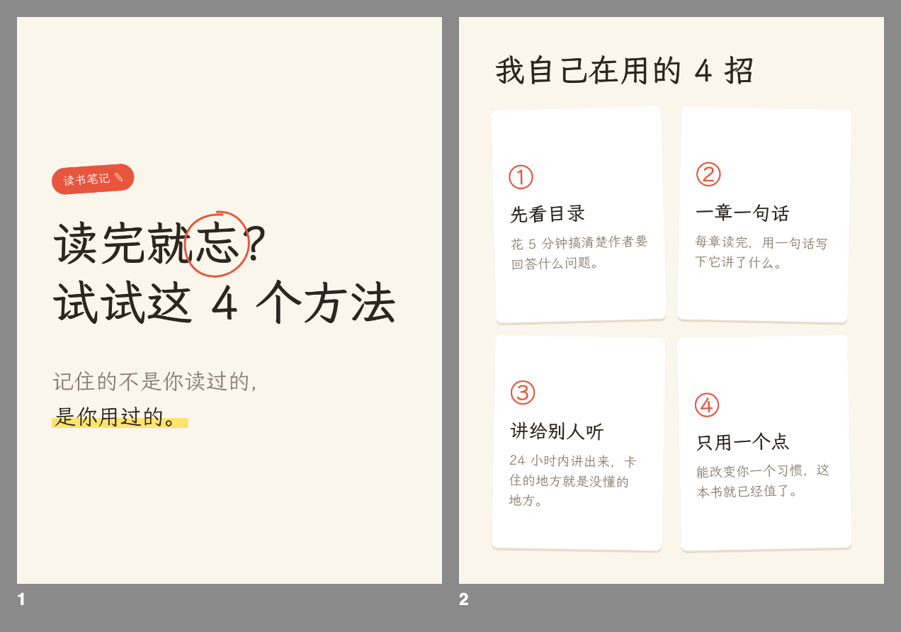
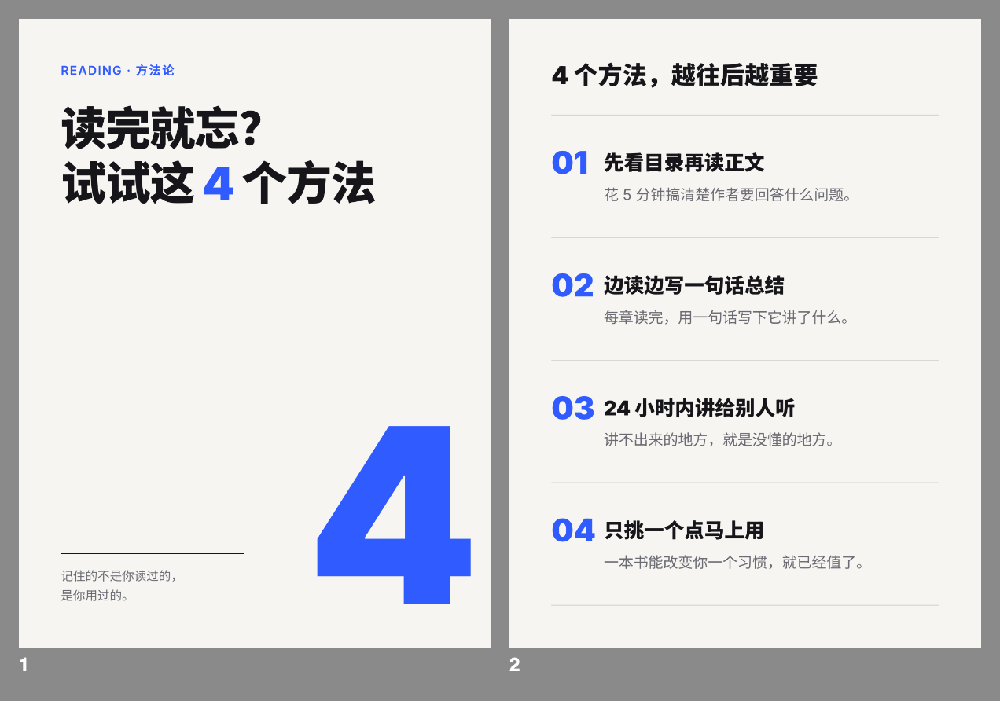
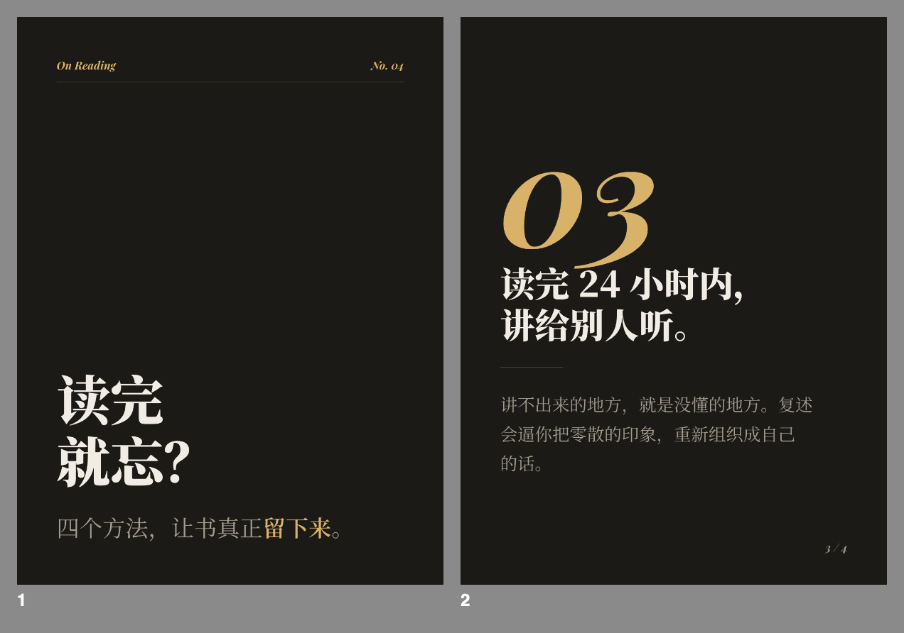
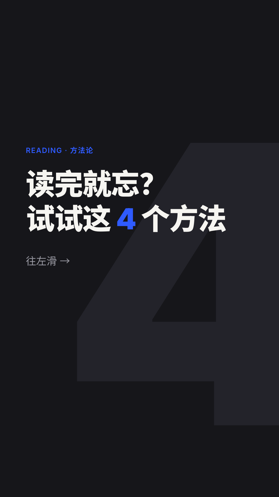

# postsmith

**postsmith 是开源的小红书图文生成器**，也能做抖音图文、TikTok 轮播图和 X 配图。把文案或想法发给 AI，它按内容现场设计排版，输出各平台尺寸的图片：小红书封面和轮播图、抖音图文、TikTok photo 轮播、X 竖图和横图。

- 文字转图片：文案、笔记、干货、读书笔记都能直接排成图文，不用自己排版，也不用套模板
- AI 排版：每次按内容设计版式，每一张图都不一样，支持封面标题、内页、结尾页和发布文案
- 多平台多尺寸：小红书 3:4，抖音 9:16 和 3:4，TikTok 9:16，X 16:9 和 4:5
- 多语言：中文、日文、韩文、英文，以及法语、西语、德语等
- 配合 Claude Code、Codex 等 AI 编程工具使用，本地渲染成 PNG（也可导出 PDF）

*Xiaohongshu (RedNote), Douyin, TikTok photo mode and X carousel image generator. Paste text, get social media images: an AI coding agent designs a fresh layout for each post and renders it to platform-sized PNGs.*

为什么有这个项目：
1. 不喜欢千篇一律的排版，希望每个内容都有自己的特色布局
2. 不想学设计和排版
3. 想让 AI 搞定一切，我只需要把控内容

怎么用：
1. 用 Claude Code、Codex 等 coding agent 打开项目
2. 把你想表达的任何文字内容，想发什么平台，喜欢什么感觉，发给 AI
3. AI 会直接根据本项目配置，导出小红书、抖音、TikTok 和 X 对应尺寸的图片

模版和样式：
1. 没有固定模板，每次由 AI 根据内容现场设计版面
2. 风格有三套：`clean` 干净商务，`notebook` 手帐笔记，`editorial` 杂志画报。不指定时 AI 按内容挑
3. 尺寸：小红书 3:4，抖音图文 9:16 或 3:4，TikTok 9:16，X 横图 16:9 或竖图 4:5
4. 语言：中文、日文、韩文、英文，以及法语、西语、德语等拉丁字母语言，HTML 的 `lang` 决定用哪套字体
5. 字体：自带在线字体，开箱就能用。AI 排版前会检查你的电脑上有没有 `fonts.json` 里推荐的字体，有就优先用；想用自己的字体，放进 `fonts/` 即可

<p>
  
  
</p>
<p>
  
  
</p>

## 快速开始

需要 Node 18 以上，以及 Claude Code、Codex 或 Antigravity 中的任意一个。

```bash
git clone <this repo> postsmith && cd postsmith
npm install
```

用 AI 工具打开项目，说明要发哪个平台、想要什么感觉，再贴上文字：

> 这段做成小红书，6 页以内，用 notebook 风格
>
> （贴入文字）

图片会输出到 `posts/<日期-短名>/out/`。想改哪里直接说，比如“第二页标题大一点”。

出图后，AI 会根据图上的文字写好发布文案（标题、正文、话题标签），存在同目录的 `caption.md`，复制就能发。

想用 ChatGPT、Gemini 等别的 AI 写文案，可以复制 [`prompts/copywriting.md`](prompts/copywriting.md) 的内容，在最后贴上原始素材交给它们。写好后贴回这里，AI 会照着排版；为了适配版面改了字，会告诉你改了哪里。

## 个人偏好

在项目根目录建一个 `CLAUDE.local.md`（Codex 用 `AGENTS.override.md`），写下你的固定偏好，比如“主色用 #FF5A5F”“每页右下角加我的账号名”。这个文件不进 git。

## 开发

想加风格、加平台尺寸、改渲染脚本，或者想了解它是怎么工作的，请看 [docs/DEVELOPMENT.md](docs/DEVELOPMENT.md)。

## License

MIT
